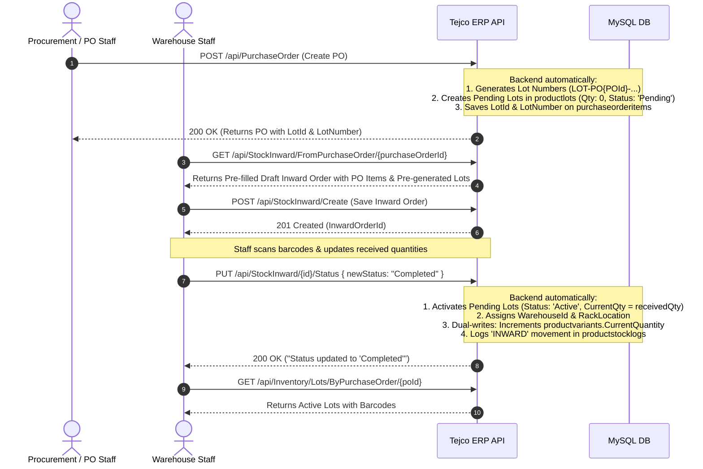

# Tejco ERP — Lot Tracking & Inventory Ledger API Documentation (Phase 0)

This document provides the API specifications, workflow changes, and example request/response payloads for the Frontend team to integrate **Phase 0: Lot Tracking and Stock Movement Logs (with Purchase Order Lot Generation)**.

---

## 📌 Executive Summary of What Changed

1. **Lot Generation at Purchase Order Creation**:
   - Unique **Lot Numbers** and barcodes (`LOT-PO{POId}-YYYYMMDD-V{VariantId}-{Seq}`) are generated **as soon as a Purchase Order is created (`POST /api/PurchaseOrder`)**.
   - These are pre-allocated in `productlots` with `Status = "Pending"`, `CurrentQuantity = 0`, and `InitialQuantity = PO Item Quantity`.
   - Physical warehouse inventory is **not** increased at this stage.
2. **Inward Order Auto-Population from PO**:
   - New endpoint `GET /api/StockInward/FromPurchaseOrder/{purchaseOrderId}` creates a pre-filled draft Inward Order carrying over PO items and their pre-generated `lotId`, `lotNumber`, and `purchasePrice`.
3. **Lot Activation upon Inward Order Completion**:
   - When the Inward Order is marked as `"Completed"` (`PUT /api/StockInward/{id}/Status`), the backend activates the pre-generated lot (`Status = "Active"`, `CurrentQuantity = receivedQty`, `WarehouseId = inwardWarehouse`).
   - Dual-write: Aggregate stock in `productvariants.CurrentQuantity` is incremented.
   - Immutable audit trail: An `"INWARD"` entry is recorded in `productstocklogs`.
   - *Fallback:* If an Inward Order is received directly without a PO, a fresh lot is generated and activated on completion.
4. **Safety Guard on Completed Orders**:
   - Once an Inward Order is `"Completed"`, calling `PUT /api/StockInward/Update/{id}` returns `400 Bad Request` to prevent accidental deletion and orphaned stock.
5. **New Inventory API (`/api/Inventory`)**:
   - Query lots by page, warehouse, product, variant, purchase order, or inward order.
   - Query stock movement ledger logs (in/out history) by date range, warehouse, or item.

---

## 🔄 End-to-End Workflow



---

## 0. Purchase Order Lot Generation & Pre-population

### 0.1 Create Purchase Order (Generates Pending Lots)

* **Endpoint:** `POST /api/PurchaseOrder`
* **Description:** When a PO is created, the backend automatically generates a unique `lotNumber` and barcode for every line item, inserts them as `"Pending"` records into `productlots` (with `CurrentQuantity = 0`), and attaches `lotId`, `lotNumber`, and `lotBarcode` to the returned PO items.

#### Response line item sample:
```json
{
  "orderItemId": 45,
  "purchaseOrderId": 12,
  "productId": 124,
  "variantId": 215,
  "sku": "SKU-VP-15MM",
  "quantity": 50,
  "unitPrice": 120.00,
  "totalPrice": 6000.00,
  "lotId": 89,
  "lotNumber": "LOT-PO12-20261015-V215-001",
  "lotBarcode": "LOT-PO12-20261015-V215-001"
}
```

---

### 0.2 Generate Draft Inward Order from Purchase Order

* **Endpoint:** `GET /api/StockInward/FromPurchaseOrder/{purchaseOrderId}`
* **Description:** Pre-populates a new inward order payload carrying the PO's vendor, order reference, items, and their pre-allocated `lotId` & `lotNumber`. The warehouse team can review, adjust `receivedQty` or `locationCode`, and submit to `POST /api/StockInward/Create`.

#### Request:
```http
GET /api/StockInward/FromPurchaseOrder/12 HTTP/1.1
Authorization: Bearer <TOKEN>
```

#### Response (200 OK):
```json
{
  "statusCode": 200,
  "success": true,
  "message": "Draft inward order pre-populated from purchase order successfully.",
  "data": {
    "inwardOrderId": 0,
    "orderNumber": "INW-PO-2026-0012",
    "vendorId": 3,
    "purchaseOrderId": 12,
    "orderDate": "2026-10-15T11:30:00Z",
    "status": "Pending",
    "priority": "Normal",
    "items": [
      {
        "productId": 124,
        "variantId": 215,
        "sku": "SKU-VP-15MM",
        "barcode": "LOT-PO12-20261015-V215-001",
        "expectedQty": 50,
        "receivedQty": 50,
        "lotId": 89,
        "lotNumber": "LOT-PO12-20261015-V215-001",
        "purchasePrice": 120.00
      }
    ]
  }
}
```

---

## 1. Updated Existing Endpoints (`/api/StockInward`)

### 1.1 Complete Inward Order (Trigger Lot Activation)

* **Endpoint:** `PUT /api/StockInward/{id}/Status`
* **Description:** Call this when warehouse staff finishes receiving items. Setting `newStatus: "Completed"` activates the pre-allocated lots (transitions status from `"Pending"` to `"Active"`, updates `CurrentQuantity = receivedQty`), updates variant stock, and creates an audit ledger entry in `productstocklogs`.

#### Request:
```http
PUT /api/StockInward/1/Status HTTP/1.1
Content-Type: application/json
Authorization: Bearer <TOKEN>
```
```json
{
  "newStatus": "Completed"
}
```

#### Response (200 OK):
```json
{
  "statusCode": 200,
  "success": true,
  "message": "Status updated to 'Completed'",
  "data": null,
  "totalCount": null,
  "error": null
}
```

---

### 1.2 Fetch Inward Order (Includes Generated Lots)

* **Endpoint:** `GET /api/StockInward/GetById/{id}`
* **Description:** Retrieves the inward order. Notice that completed items now have `lotId`, `lotNumber`, and `purchasePrice` populated.

#### Request:
```http
GET /api/StockInward/GetById/1 HTTP/1.1
Authorization: Bearer <TOKEN>
```

#### Response (200 OK):
```json
{
  "statusCode": 200,
  "success": true,
  "message": "Inward order retrieved successfully",
  "data": {
    "inwardOrderId": 1,
    "orderNumber": "INW-715348",
    "vendorId": 3,
    "vendorName": "Surgical Instruments Co.",
    "warehouseId": 1,
    "warehouseName": "Parla Warehouse",
    "warehouseCode": "WH-PARLA",
    "orderDate": "2026-10-14T00:00:00",
    "status": "Completed",
    "priority": "Normal",
    "receiverName": "Rajesh Kumar",
    "createdAt": "2026-10-14T10:15:30",
    "updatedAt": "2026-10-14T11:45:00",
    "items": [
      {
        "inwardOrderItemId": 101,
        "inwardOrderId": 1,
        "productId": 124,
        "variantId": 215,
        "productName": "Skin Product - Vitiligo Punch",
        "variantName": "1.5 mm Curved",
        "sku": "SKU-VP-15MM",
        "barcode": "8901234567890",
        "expectedQty": 50,
        "receivedQty": 50,
        "locationCode": "RACK-A1",
        "lotId": 1,
        "lotNumber": "LOT-20261014-0001-V215-001",
        "purchasePrice": 120.00
      },
      {
        "inwardOrderItemId": 102,
        "inwardOrderId": 1,
        "productId": 125,
        "variantId": 220,
        "productName": "Hair Transplant Forceps",
        "variantName": "Angled Titanium",
        "sku": "SKU-HTF-ANG",
        "barcode": "8909876543210",
        "expectedQty": 30,
        "receivedQty": 30,
        "locationCode": "RACK-B2",
        "lotId": 2,
        "lotNumber": "LOT-20261014-0001-V220-002",
        "purchasePrice": 450.00
      }
    ],
    "scanHistory": [
      {
        "scanId": 1,
        "inwardOrderId": 1,
        "barcode": "8901234567890",
        "message": "Item verified successfully",
        "scanType": "Success",
        "productName": "Skin Product - Vitiligo Punch",
        "scannedAt": "2026-10-14T10:30:15"
      }
    ]
  },
  "totalCount": null,
  "error": null
}
```

---

### 1.3 Create Inward Order (Now Supports `VariantId` & `PurchasePrice`)

* **Endpoint:** `POST /api/StockInward/Create`
* **Description:** Create draft inward order. Items can now optionally specify `purchasePrice`.

#### Request:
```http
POST /api/StockInward/Create HTTP/1.1
Content-Type: application/json
Authorization: Bearer <TOKEN>
```
```json
{
  "orderNumber": "INW-202610-002",
  "vendorId": 3,
  "vendorName": "Surgical Instruments Co.",
  "warehouseId": 1,
  "warehouseName": "Parla Warehouse",
  "warehouseCode": "WH-PARLA",
  "orderDate": "2026-10-15T00:00:00.000Z",
  "priority": "Normal",
  "receiverName": "Rajesh Kumar",
  "items": [
    {
      "productId": 124,
      "variantId": 215,
      "productName": "Skin Product - Vitiligo Punch",
      "variantName": "1.5 mm Curved",
      "sku": "SKU-VP-15MM",
      "barcode": "8901234567890",
      "expectedQty": 25,
      "receivedQty": 25,
      "locationCode": "RACK-A1",
      "purchasePrice": 120.00
    }
  ]
}
```

#### Response (201 Created):
```json
{
  "statusCode": 201,
  "success": true,
  "message": "Inward order created successfully",
  "data": {
    "inwardOrderId": 2
  },
  "totalCount": null,
  "error": null
}
```

---

## 2. New Inventory Lots Endpoints (`/api/Inventory`)

### 2.1 Get Paginated Lots (Warehouse / Admin Inventory View)

* **Endpoint:** `GET /api/Inventory/Lots`
* **Query Parameters:**
  * `pageNumber` (int, default: 1)
  * `pageSize` (int, default: 10)
  * `warehouseId` (int, optional)
  * `productId` (int, optional)
  * `variantId` (int, optional)
  * `status` (string, optional: e.g. `'Active'`)
  * `searchTerm` (string, optional: matches Lot Number, Product Name, or Variant Name)

#### Request:
```http
GET /api/Inventory/Lots?pageNumber=1&pageSize=10&warehouseId=1&searchTerm=Vitiligo HTTP/1.1
Authorization: Bearer <TOKEN>
```

#### Response (200 OK):
```json
{
  "statusCode": 200,
  "success": true,
  "message": "Product lots retrieved successfully",
  "data": [
    {
      "lotId": 1,
      "lotNumber": "LOT-20261014-0001-V215-001",
      "productId": 124,
      "productName": "Skin Product - Vitiligo Punch",
      "variantId": 215,
      "variantName": "1.5 mm Curved",
      "skuSuffix": "15MM",
      "warehouseId": 1,
      "warehouseName": "Parla Warehouse",
      "rackLocation": "RACK-A1",
      "initialQuantity": 50,
      "currentQuantity": 50,
      "reservedQuantity": 0,
      "availableQuantity": 50,
      "inwardDate": "2026-10-14T11:45:00",
      "purchasePrice": 120.00,
      "lotBarcode": "LOT-20261014-0001-V215-001",
      "inwardOrderId": 1,
      "inwardOrderItemId": 101,
      "status": "Active",
      "createdAt": "2026-10-14T11:45:00",
      "updatedAt": "2026-10-14T11:45:00"
    }
  ],
  "totalCount": 1,
  "error": null
}
```

---

### 2.2 Get Single Lot Details

* **Endpoint:** `GET /api/Inventory/Lots/{lotId}`
* **Description:** Fetch complete batch details for a specific lot.

#### Request:
```http
GET /api/Inventory/Lots/1 HTTP/1.1
Authorization: Bearer <TOKEN>
```

#### Response (200 OK):
```json
{
  "statusCode": 200,
  "success": true,
  "message": "Product lot retrieved successfully",
  "data": {
    "lotId": 1,
    "lotNumber": "LOT-20261014-0001-V215-001",
    "productId": 124,
    "productName": "Skin Product - Vitiligo Punch",
    "variantId": 215,
    "variantName": "1.5 mm Curved",
    "skuSuffix": "15MM",
    "warehouseId": 1,
    "warehouseName": "Parla Warehouse",
    "rackLocation": "RACK-A1",
    "initialQuantity": 50,
    "currentQuantity": 50,
    "reservedQuantity": 0,
    "availableQuantity": 50,
    "inwardDate": "2026-10-14T11:45:00",
    "purchasePrice": 120.00,
    "lotBarcode": "LOT-20261014-0001-V215-001",
    "inwardOrderId": 1,
    "inwardOrderItemId": 101,
    "status": "Active",
    "createdAt": "2026-10-14T11:45:00",
    "updatedAt": "2026-10-14T11:45:00"
  },
  "totalCount": null,
  "error": null
}
```

---

### 2.3 Get Lots By Variant ID

* **Endpoint:** `GET /api/Inventory/Lots/ByVariant/{variantId}`
* **Description:** Used in product variant cards / picking screens to see which batches are in stock (sorted FIFO by `inwardDate`).

#### Request:
```http
GET /api/Inventory/Lots/ByVariant/215 HTTP/1.1
Authorization: Bearer <TOKEN>
```

#### Response (200 OK):
```json
{
  "statusCode": 200,
  "success": true,
  "message": "Lots retrieved for variant successfully",
  "data": [
    {
      "lotId": 1,
      "lotNumber": "LOT-20261014-0001-V215-001",
      "productId": 124,
      "productName": "Skin Product - Vitiligo Punch",
      "variantId": 215,
      "variantName": "1.5 mm Curved",
      "warehouseId": 1,
      "warehouseName": "Parla Warehouse",
      "rackLocation": "RACK-A1",
      "currentQuantity": 50,
      "availableQuantity": 50,
      "inwardDate": "2026-10-14T11:45:00"
    }
  ],
  "totalCount": 1,
  "error": null
}
```

---

### 2.4 Get Lots By Inward Order ID (Print Barcode Stickers)

* **Endpoint:** `GET /api/Inventory/Lots/ByInwardOrder/{inwardOrderId}`
* **Description:** Call this right after completing an inward order to display and **print lot barcode labels / stickers**.

#### Request:
```http
GET /api/Inventory/Lots/ByInwardOrder/1 HTTP/1.1
Authorization: Bearer <TOKEN>
```

#### Response (200 OK):
```json
{
  "statusCode": 200,
  "success": true,
  "message": "Lots retrieved for inward order successfully",
  "data": [
    {
      "lotId": 1,
      "lotNumber": "LOT-20261014-0001-V215-001",
      "productId": 124,
      "productName": "Skin Product - Vitiligo Punch",
      "variantId": 215,
      "variantName": "1.5 mm Curved",
      "warehouseId": 1,
      "warehouseName": "Parla Warehouse",
      "rackLocation": "RACK-A1",
      "initialQuantity": 50,
      "currentQuantity": 50,
      "lotBarcode": "LOT-20261014-0001-V215-001"
    },
    {
      "lotId": 2,
      "lotNumber": "LOT-20261014-0001-V220-002",
      "productId": 125,
      "productName": "Hair Transplant Forceps",
      "variantId": 220,
      "variantName": "Angled Titanium",
      "warehouseId": 1,
      "warehouseName": "Parla Warehouse",
      "rackLocation": "RACK-B2",
      "initialQuantity": 30,
      "currentQuantity": 30,
      "lotBarcode": "LOT-20261014-0001-V220-002"
    }
  ],
  "totalCount": 2,
  "error": null
}
```

> [!TIP]
> **Barcode Printing**: Pass `lotBarcode` (or `lotNumber`) to standard JS barcode rendering libraries (such as `JsBarcode` for CODE128) to render printable sticker labels.

---

## 3. Stock Movement Ledger API (`/api/Inventory/StockLogs`)

* **Endpoint:** `GET /api/Inventory/StockLogs`
* **Description:** Returns the **immutable inventory transaction ledger**. Shows every Inward, Outward/Dispatch, Transfer, Adjustment, and Return with opening/closing balances.
* **Query Parameters:**
  * `pageNumber` (int, default: 1)
  * `pageSize` (int, default: 10)
  * `warehouseId` (int, optional)
  * `productId` (int, optional)
  * `variantId` (int, optional)
  * `lotId` (int, optional)
  * `transactionType` (string, optional: e.g. `'INWARD'`, `'DISPATCH'`, `'TRANSFER_OUT'`, `'TRANSFER_IN'`, `'ADJUSTMENT'`, `'RETURN'`, `'OPENING_BALANCE'`)
  * `startDate` (ISO DateTime, optional: e.g. `2026-10-01T00:00:00`)
  * `endDate` (ISO DateTime, optional: e.g. `2026-10-31T23:59:59`)

#### Request:
```http
GET /api/Inventory/StockLogs?pageNumber=1&pageSize=10&warehouseId=1&transactionType=INWARD HTTP/1.1
Authorization: Bearer <TOKEN>
```

#### Response (200 OK):
```json
{
  "statusCode": 200,
  "success": true,
  "message": "Stock movement logs retrieved successfully",
  "data": [
    {
      "logId": 1,
      "transactionDate": "2026-10-14T11:45:00",
      "transactionType": "INWARD",
      "productId": 124,
      "productName": "Skin Product - Vitiligo Punch",
      "variantId": 215,
      "variantName": "1.5 mm Curved",
      "skuSuffix": "15MM",
      "lotId": 1,
      "lotNumber": "LOT-20261014-0001-V215-001",
      "warehouseId": 1,
      "warehouseName": "Parla Warehouse",
      "quantityIn": 50,
      "quantityOut": 0,
      "quantityChange": 50,
      "balanceQuantity": 50,
      "referenceType": "InwardOrder",
      "referenceId": 1,
      "referenceNumber": "INW-715348",
      "unitPrice": 120.00,
      "remarks": "Inward receipt completed for order INW-715348 (Surgical Instruments Co.)",
      "createdBy": 12,
      "createdByName": "Rajesh Kumar",
      "createdAt": "2026-10-14T11:45:00"
    }
  ],
  "totalCount": 1,
  "error": null
}
```

---

## 4. UI Recommendations for Frontend Developers

| UI View | Recommended Integration |
| :--- | :--- |
| **Inward Order Detail** | Display the assigned `Lot Number` alongside each received item once the order is in `Completed` status. |
| **Print Lot Stickers Button** | Add a **"Print Barcode Labels"** button on completed inward orders that calls `GET /api/Inventory/Lots/ByInwardOrder/{id}` and prints Code128 barcode stickers. |
| **Warehouse Stock View** | Add an **"Inventory Batches / Lots"** tab using `GET /api/Inventory/Lots` with search, warehouse filter, and pagination. |
| **Stock Movement History** | Add a **"Stock Movement Ledger"** tab using `GET /api/Inventory/StockLogs` with date pickers, warehouse filter, and transaction type filter. |

---

## 5. Error Handling

| Scenario | HTTP Status | Example Response |
| :--- | :---: | :--- |
| **Trying to edit a Completed Inward Order** | `400 Bad Request` | `{"statusCode": 400, "success": false, "message": "Cannot update an inward order that is already Completed.", "data": null, "error": null}` |
| **Lot Not Found** | `404 Not Found` | `{"statusCode": 404, "success": false, "message": "Product lot 999 not found", "data": null, "error": null}` |
| **Invalid Status Transition** | `400 Bad Request` | `{"statusCode": 400, "success": false, "message": "Invalid status transition from 'Completed' to 'Pending'.", "data": null, "error": null}` |
